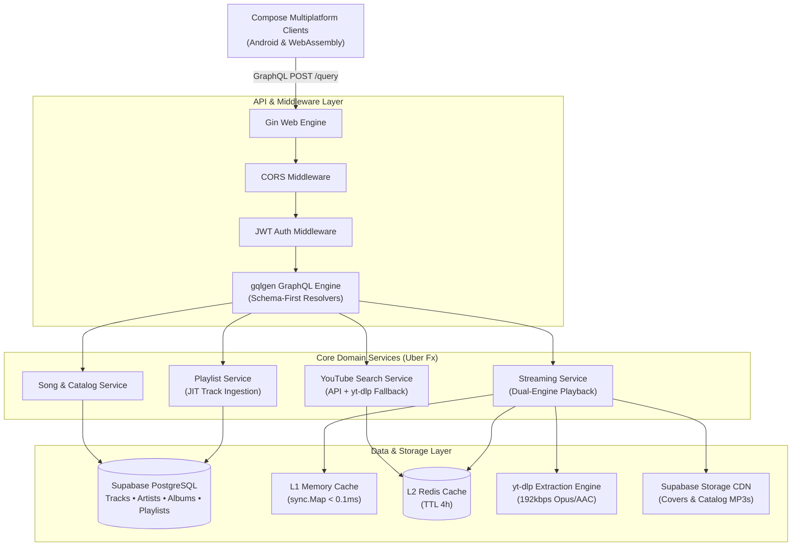

# 🚀 Vvinamp Backend — High-Concurrency Go GraphQL Music Service

[](https://golang.org/)
[](https://gqlgen.com/)
[-336791?style=for-the-badge&logo=postgresql&logoColor=white)](https://supabase.com/)
[](https://redis.io/)
[](https://www.docker.com/)

> High-concurrency backend service powering **Vvinamp**. Built in Go using a schema-first GraphQL API, Uber Fx dependency injection, Supabase PostgreSQL, Redis caching, and an on-demand live streaming engine that eliminates cloud audio storage costs.

🌐 **Production API Endpoint:** `https://vvinamp-backend.onrender.com/query`

---

## 🏗️ System Architecture



---

## ⚙️ Key Architectural Decisions & Engineering Highlights

### 1. Dual-Engine Hybrid Playback Resolver
* **Problem:** Storing thousands of high-bitrate MP3 files in cloud storage introduces steep bandwidth egress costs and storage quotas.
* **Solution:** Built a hybrid playback resolver in [`package/streaming/service.go`](file:///Users/joel/Programming/jerman/vvinamp-backend/package/streaming/service.go):
  - **Option A (Catalog MP3s):** If a track record contains an `audio_file_url`, the server directly serves the pre-hosted Supabase MP3 CDN endpoint in $< 2\text{ ms}$.
  - **Option B (On-Demand 192kbps Live Streaming):** If the track points to a `youtube_id` (or direct search result), the server extracts live signed audio streams via `yt-dlp` on the fly.
  - **Two-Tier Caching:** Extracted signed streams are stored in an L1 in-memory cache (`sync.Map`, $< 0.1\text{ ms}$) and synchronized with an L2 Redis cache (4-hour TTL). Subsequent plays for popular tracks hit the cache with near-zero CPU overhead.

### 2. Resilient YouTube Search Engine with Automated 403 Fallback
* **Problem:** YouTube Data API v3 enforces a daily quota cap (10,000 units), easily exhausted in production.
* **Solution:** Implemented automated degradation in [`internal/services/youtube/search.go`](file:///Users/joel/Programming/jerman/vvinamp-backend/internal/services/youtube/search.go):
  - Primary searches query the Google YouTube API for fast metadata resolution.
  - Upon receiving HTTP 403 `quotaExceeded`, the service logs a warning and automatically falls back to an optimized limit-aware `yt-dlp` scraping engine (`--flat-playlist`, `--skip-download`).
  - Search execution drops from standard 15s down to $\sim 1.3\text{s}$, preventing client GraphQL failures.

### 3. Just-in-Time (JIT) Relational Ingestion
* **Problem:** User-discovered YouTube search results don't exist in the relational database. Adding them to playlists could violate relational foreign key constraints in `playlist_track`.
* **Solution:** Implemented the `addYoutubeTrackToPlaylist` GraphQL mutation. When a user bookmarks a YouTube search result, the backend checks if a track with that `youtube_id` exists. If missing, it auto-generates a UUID, creates a track with `audio_file_url = NULL`, links the channel as artist, and inserts the junction record `(playlist_id, track_id, position)` with strict foreign key integrity.

### 4. Dependency Injection via Uber Fx
* **Architecture:** The application utilizes [Uber Fx](https://github.com/uber-go/fx) for application lifecycle and dependency injection. Services, repositories, database connection pools, and controllers are cleanly registered in modular configuration bundles (`module/module.go`, `module/service.go`, `module/repository.go`).

---

## 🛠️ Tech Stack & Dependencies

| Component | Technology | Role |
| :--- | :--- | :--- |
| **Language** | [Go 1.22+](https://golang.org/) | Concurrent, low-latency microservice runtime |
| **Web Engine** | [Gin](https://gin-gonic.com/) | High-performance HTTP router and middleware |
| **GraphQL** | [gqlgen](https://gqlgen.com/) | Schema-first code generator with type safety |
| **Dependency Injection**| [Uber Fx](https://github.com/uber-go/fx) | Modular DI and clean lifecycle management |
| **ORM & Database** | [GORM](https://gorm.io/) & [PostgreSQL](https://supabase.com/) | Relational modeling, indexing, connection pooling |
| **Migrations** | [golang-migrate](https://github.com/golang-migrate/migrate) | Versioned SQL DDL scripts |
| **Caching** | [go-redis](https://github.com/redis/go-redis) | L2 Redis cache for stream URLs & session data |
| **Audio Engine** | `yt-dlp` + FFmpeg | Live audio extraction and metadata matching |
| **Deployment** | Docker on [Render](https://render.com/) | Multi-stage Docker container with automated CI/CD |

---

## 📂 Project Structure

```text
vvinamp-backend/
├── cmd/
│   ├── main.go               # Application entrypoint
│   └── seeder/               # Database seeder scripts (Music, Artists, Albums)
├── controller/               # HTTP controllers, CORS middleware, File server
├── internal/
│   ├── pkg/
│   │   ├── db/migrations/    # Versioned PostgreSQL migration scripts (.sql)
│   │   └── session/          # User authentication and session validation
│   └── services/youtube/     # YouTube API search, yt-dlp fallback engine
├── graphql/
│   ├── generated/            # gqlgen auto-generated runtime code
│   ├── model/                # GraphQL generated models
│   ├── resolvers/            # Query and Mutation resolver implementations
│   └── schema/               # GraphQL schema files (.graphqls)
├── package/                  # Clean domain packages
│   ├── artist/               # Artist domain & repositories
│   ├── history/              # Listening history tracking
│   ├── playlist/             # Playlist CRUD & JIT track insertion
│   ├── song/                 # Track models & catalog queries
│   └── streaming/            # Dual-engine playback resolver & cache
├── module/                   # Uber Fx dependency injection modules
├── Dockerfile                # Production multi-stage Alpine container
└── render-build.sh           # Cloud build script
```

---

## 🚀 Local Development Setup

### 1. Prerequisites
- **Go 1.22+**
- **Docker & Docker Compose** (for local PostgreSQL & Redis)
- **yt-dlp** and **ffmpeg** installed locally

### 2. Environment Configuration
Create a `.env` file in the root directory:
```env
PORT=8080
ENV=local
GIN_MODE=debug
POSTGRE_URL="host=127.0.0.1 port=5432 user=your-user password=your-password dbname=vvinamp sslmode=disable"
REDIS_URL="redis://127.0.0.1:6379/0"
YT_API_KEY=your_youtube_data_api_key
TOKEN_PASSWORD=your_jwt_secret_token
CORS_ALLOW_ORIGINS=http://localhost:8080,https://vvinamp.cirio.my.id,*
```

### 3. Run Database Migrations
```bash
migrate -path=internal/pkg/db/migrations/postgresql -database "$POSTGRE_URL" up
```

### 4. Code Generation (GraphQL)
When updating schema `.graphqls` files, regenerate resolver bindings:
```bash
go run github.com/99designs/gqlgen generate
```

### 5. Run the Server
```bash
go run main.go
```

The GraphQL playground will be available at: `http://localhost:8080/v1/graphiql`

### 6. Run Tests
```bash
go test -v ./package/streaming
```
